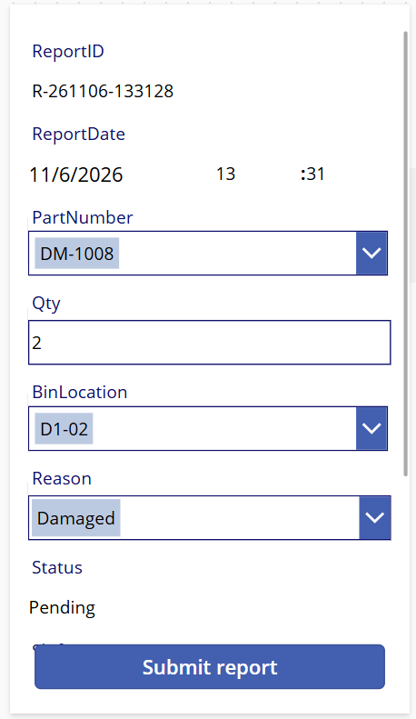
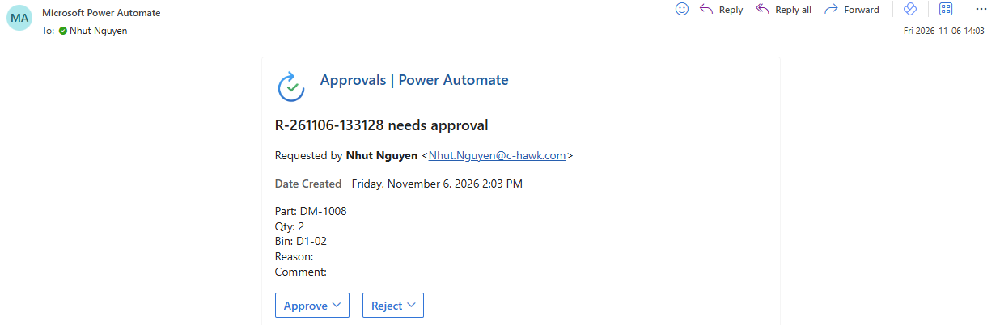
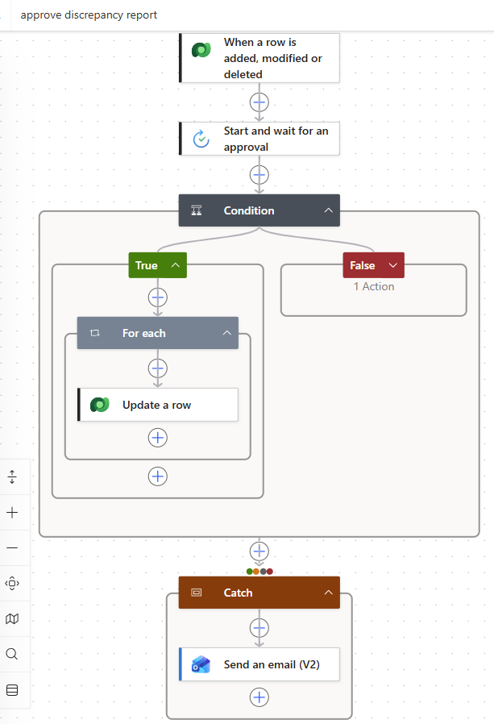
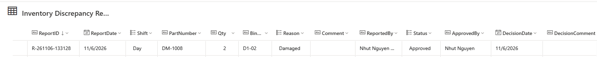
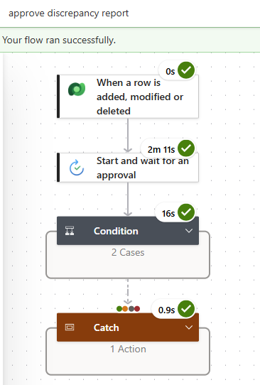
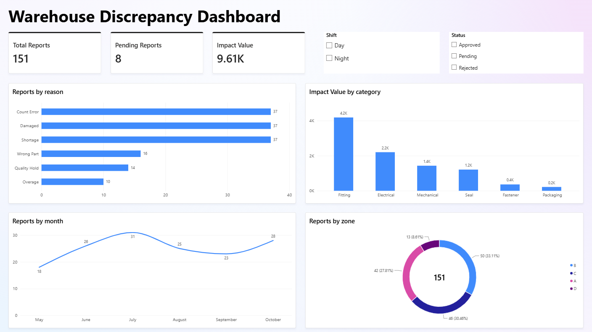

# Warehouse Discrepancy Report

A mobile-ready workflow for reporting and approving warehouse material discrepancies, built on the Microsoft Power Platform: **Power Apps, Dataverse, Power Automate and Power BI**.

> **Sample data only.** All parts, names, locations and figures in this project are fictional. It contains no data from any employer.

## Demo

[Watch the 90-second demo on YouTube](https://youtu.be/lb9dz5eJ1OQ)

The demo shows: submitting a report in the app, approving it by email, the record updating in Dataverse, and the analytics dashboard.

## Screenshots

| Report form (Power Apps) | Approval email |
|---|---|
|  |  |

| Approval flow (Power Automate) | Updated record (Dataverse) |
|---|---|
|  |  |

| Flow run history | Dashboard (Power BI) |
|---|---|
|  |  |

## How it works

1. A warehouse user opens the phone-layout app and fills in the report. Report ID, date, status (Pending) and reporter are filled in automatically. Part and bin are picked from searchable lists.
2. The report is saved as a new row in Dataverse.
3. A cloud flow starts on the new row and sends an approval request by email with Approve and Reject buttons.
4. The decision is written back to the record: status, approver, decision date and comment.
5. If any step fails, a Catch scope sends an alert email with a link to the failed run.
6. A Power BI dashboard summarises the sample data by reason, category, zone and month.

```
Power Apps form --> Dataverse (4 tables) --> Power Automate approval --+
                          ^                                            |
                          +---------- decision written back -----------+

Sample dataset (Excel) --> Power BI dashboard
```

## Data model

| Table | Purpose | Rows |
|---|---|---|
| Part | Part master: number, description, category, UOM, unit cost, default bin | 40 |
| Warehouse Bin | Bin locations and zones | 12 |
| Inventory Adjustment Reason | Discrepancy reasons (Damaged, Shortage, Overage, Wrong Part, Count Error, Quality Hold) | 6 |
| Inventory Discrepancy Report | One row per report, with status and decision details | 151 |

In Power BI the three lookup tables relate to the reports table on part number, bin location and reason. Measures: `Total Reports`, `Pending Reports` and `Impact Value` (quantity x unit cost).

## Design decisions

- **The flow triggers only when a row is added**, so updating the status never starts the flow again.
- **Choice columns are shown as readable text** in the approval email instead of numeric codes.
- **Error handling:** a Catch scope sends an alert with a link to the failed run.
- **Auto-filled fields** (ID, date, status, reporter) reduce typing mistakes on a phone.
- **Text keys** are used between tables to keep the model simple.

## Repository contents

| Path | Content |
|---|---|
| `data/discrepancy_sample_data.xlsx` | The fictional sample dataset |
| `powerbi/Warehouse_Discrepancy_Dashboard.pbix` | The dashboard (open with Power BI Desktop; the data is embedded) |
| `docs/screenshots/` | Screenshots used above |

## What I would improve next

- Replace the text keys with real Dataverse lookup relationships.
- Add a date table and time-intelligence measures to the dashboard.
- Notify the reporter of the decision and connect the dashboard live to Dataverse.
- Add role-based access and a deployment pipeline between development and production.

## Author

[Nhut Nguyen] | [www.linkedin.com/in/nhut-nguyen-644952406]
